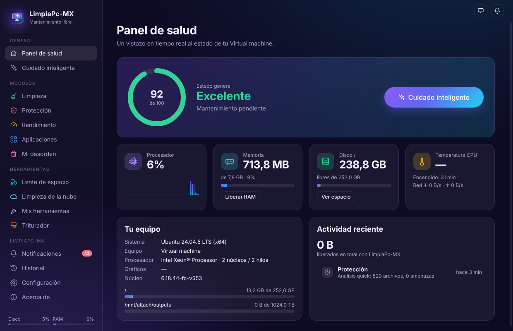
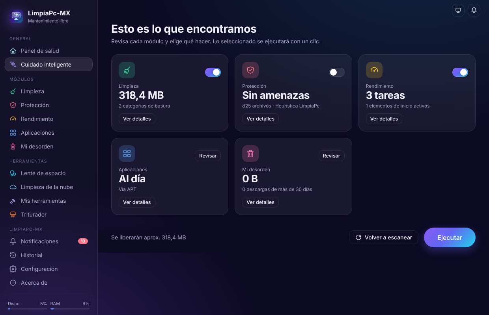
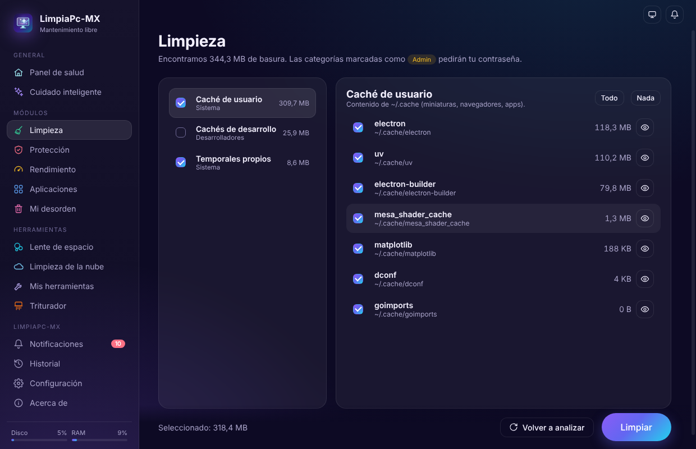
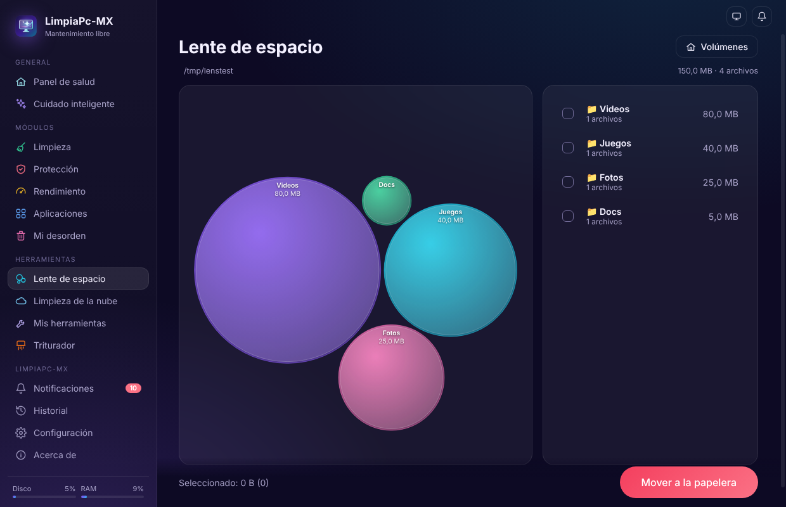
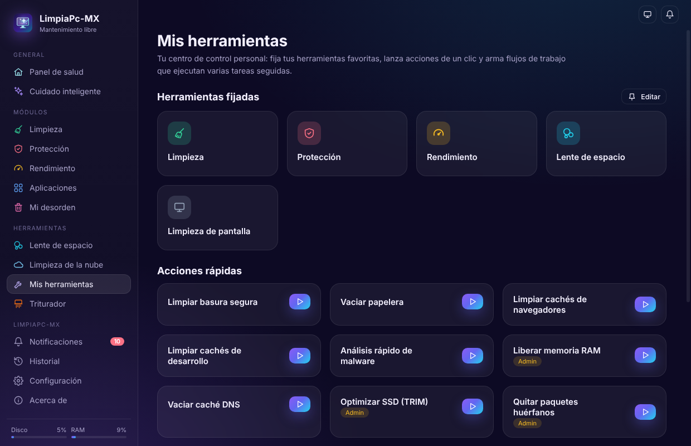
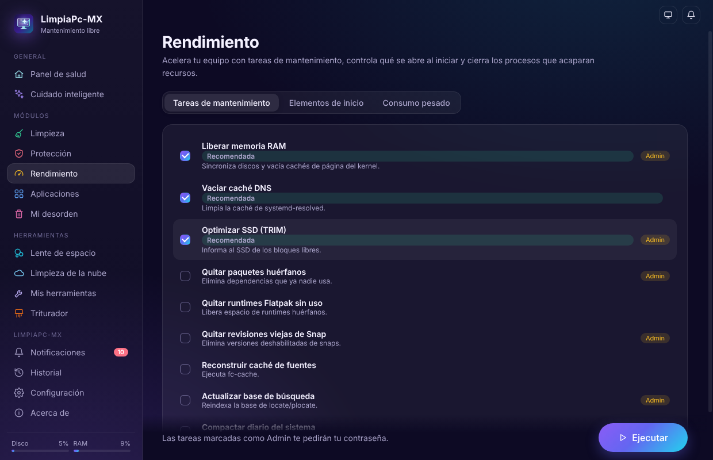
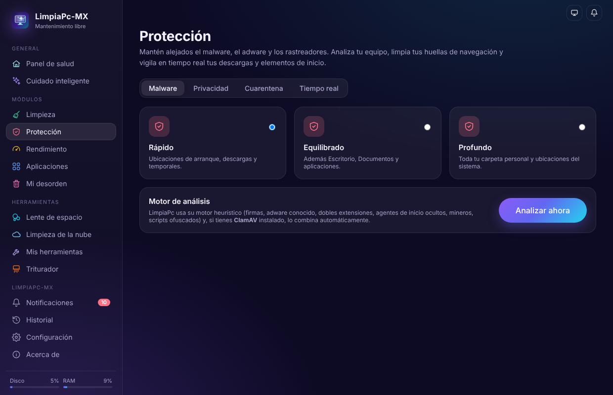

<p align="center"></p>

<h1 align="center">LimpiaPc-MX</h1>
<p align="center"><b>Suite integral y libre de mantenimiento para tu computadora</b><br>
Limpia · Protege · Acelera · Ordena — en <b>macOS</b>, <b>Windows</b> y <b>Linux</b></p>

<p align="center">
  <a href="https://github.com/chago2850-blip/LimpiaPc-MX/releases/latest"><b>⬇️ Descargar instaladores</b></a> ·
  Licencia <a href="LICENSE">GPL-3.0-or-later</a>
</p>



LimpiaPc-MX es una alternativa de **código abierto** a CleanMyMac, con sus mismos módulos y herramientas, sin suscripciones ni funciones bloqueadas, y disponible para los tres sistemas operativos de escritorio. Todo funciona localmente: no envía datos a ningún servidor.

## Módulos

| Módulo | Qué hace |
|---|---|
| **Panel de salud** | CPU, RAM, discos, batería (salud y ciclos), temperatura, red y tiempo encendido en tiempo real, con una calificación de salud del 0 al 100 y alertas. |
| **Cuidado inteligente** | Un solo escaneo que revisa Limpieza, Protección, Rendimiento, Aplicaciones y Desorden, y ejecuta todo lo seleccionado con un clic. |
| **Limpieza** | Cachés de usuario y del sistema, registros, informes de fallos, temporales, papelera, cachés de navegadores (Chrome, Edge, Firefox, Brave, Safari, Opera), cachés de desarrollo (npm, pip, Yarn, Gradle, Go, Cargo, NuGet, Xcode), descargas incompletas, caché de Windows Update, paquetes APT/DNF/Pacman, diario de systemd, respaldos viejos de iOS… |
| **Protección** | Análisis de malware Rápido / Equilibrado / Profundo con motor heurístico propio (firmas, adware conocido, mineros, dobles extensiones, agentes de inicio ocultos, scripts ofuscados) + **ClamAV** si está instalado. Cuarentena con restauración, limpieza de privacidad (historial, cookies, autocompletado, sesiones, documentos recientes) y **protección en tiempo real** de Descargas y elementos de inicio. |
| **Rendimiento** | Tareas de mantenimiento por sistema (liberar RAM, vaciar DNS, TRIM, reindexar Spotlight, SFC/DISM, scripts de mantenimiento, reparar permisos, caché de fuentes…), gestor de **elementos de inicio** (activar/desactivar/eliminar) y **consumo pesado** (procesos que más CPU/RAM usan). |
| **Aplicaciones** | **Desinstalador completo** con detección de restos, **restablecer** apps, **actualizador** (winget, Homebrew, mas, softwareupdate, APT, DNF, Pacman, Flatpak, Snap), **restos huérfanos** de apps ya borradas y gestor de **extensiones** de navegadores. |
| **Mi desorden** | Archivos grandes y antiguos, **duplicados** por contenido (aunque tengan otro nombre), **imágenes similares** (hash perceptual) y descargas acumuladas. |
| **Lente de espacio** | Mapa interactivo de burbujas del almacenamiento: navega por carpetas y libera espacio directamente. |
| **Limpieza de la nube** | iCloud Drive, OneDrive, Google Drive, Dropbox, Nextcloud, MEGA, pCloud: cuánto ocupan localmente, **liberar copia local** sin borrarla de la nube (iCloud/OneDrive/File Provider) o eliminar. |
| **Mis herramientas** | Fija tus herramientas favoritas, acciones de un clic y **flujos de trabajo** personalizados que encadenan varias tareas. |
| **Triturador** | Borrado seguro con 1, 3 o 7 pasadas de sobrescritura, renombrado y eliminación. |
| **Menú / bandeja** | Panel rápido en la barra de menús (macOS) o bandeja (Windows/Linux) con CPU, RAM, disco, red, batería, procesos pesados y acciones rápidas. |
| **Modo limpieza de pantalla** | Pantalla negra que bloquea teclado, ratón y panel táctil para limpiar la pantalla (mantén **Esc** 3 s para salir). |
| **Centro de notificaciones** | Avisos de disco lleno, RAM alta, temperatura, salud de batería, amenazas y recordatorios de mantenimiento. |
| **Historial y configuración** | Registro de todo lo hecho, espacio liberado total, tema claro/oscuro, exclusiones, papelera vs. borrado permanente, inicio con el sistema. |

## Capturas

| | |
|---|---|
|  |  |
|  |  |
|  |  |

## Instalación

Descarga el instalador de tu sistema desde **[Releases](https://github.com/chago2850-blip/LimpiaPc-MX/releases/latest)**:

| Sistema | Archivo |
|---|---|
| Windows 10/11 | `LimpiaPc-MX-x.y.z-win-x64.exe` (instalador) o `…-win-portable.exe` |
| macOS 11+ (Intel y Apple Silicon) | `LimpiaPc-MX-x.y.z-mac-universal.dmg` |
| Linux (cualquier distro) | `LimpiaPc-MX-x.y.z-linux-x86_64.AppImage` |
| Ubuntu / Debian / Mint | `LimpiaPc-MX-x.y.z-linux-amd64.deb` → `sudo apt install ./LimpiaPc-MX-*.deb` |
| Fedora / openSUSE | `LimpiaPc-MX-x.y.z-linux-x86_64.rpm` → `sudo dnf install ./LimpiaPc-MX-*.rpm` |

> **macOS:** la app no está notarizada. La primera vez: clic derecho → **Abrir**, o `xattr -cr /Applications/LimpiaPc-MX.app`. Para limpiar la Papelera y datos de Safari, concede **Acceso total al disco** en *Ajustes del Sistema → Privacidad y seguridad*.
>
> **Windows:** si SmartScreen avisa, pulsa **Más información → Ejecutar de todas formas**.

## Seguridad ante todo

- Las cachés y registros se borran porque el sistema los regenera; **tus archivos personales van a la papelera** por defecto.
- Las operaciones del sistema piden contraseña de administrador (UAC / pkexec / macOS) solo cuando hace falta.
- **Lista de exclusiones**: carpetas que LimpiaPc-MX jamás tocará.
- Cuarentena reversible para amenazas y respaldo de elementos de inicio desactivados.

## Desarrollo

```bash
git clone https://github.com/chago2850-blip/LimpiaPc-MX
cd LimpiaPc-MX
npm install
npm start            # ejecutar
npm test             # prueba automática de los módulos (requiere entorno gráfico o xvfb-run)
npm run dist:linux   # AppImage, .deb y .rpm
npm run dist:win     # instalador NSIS y portable
npm run dist:mac     # .dmg y .zip universales
```

Los instaladores para los tres sistemas se generan automáticamente con GitHub Actions al publicar una etiqueta `v*` (`.github/workflows/instaladores.yml`).

**Estructura**

```
src/main/            proceso principal (Electron / Node.js)
  core/              utilidades, configuración y notificaciones
  modules/           cleanup, protection, performance, apps, clutter, storage, health, smartcare
src/renderer/        interfaz (HTML/CSS/JS sin dependencias)
  modules/           una vista por módulo
assets/  build/      logo e iconos
```

## Licencia

Copyright © 2026 **Santiago Miguel** · chago2850@gmail.com · 744 354 8848

Este programa es software libre: puedes redistribuirlo y/o modificarlo bajo los términos de la **Licencia Pública General GNU** publicada por la Free Software Foundation, ya sea la **versión 3** de la Licencia o (a tu elección) **cualquier versión posterior**. Consulta el archivo [LICENSE](LICENSE).

*CleanMyMac es una marca de MacPaw. LimpiaPc-MX es un proyecto independiente, sin relación con MacPaw, escrito desde cero.*
